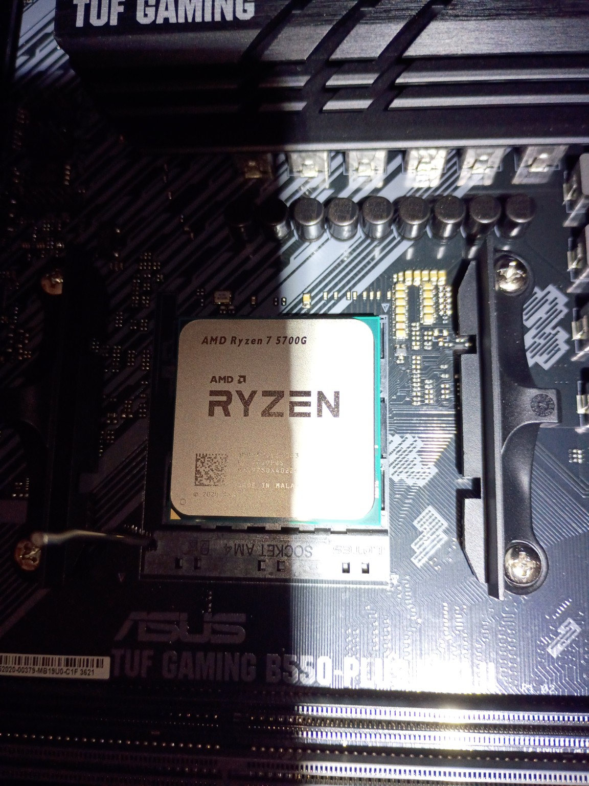
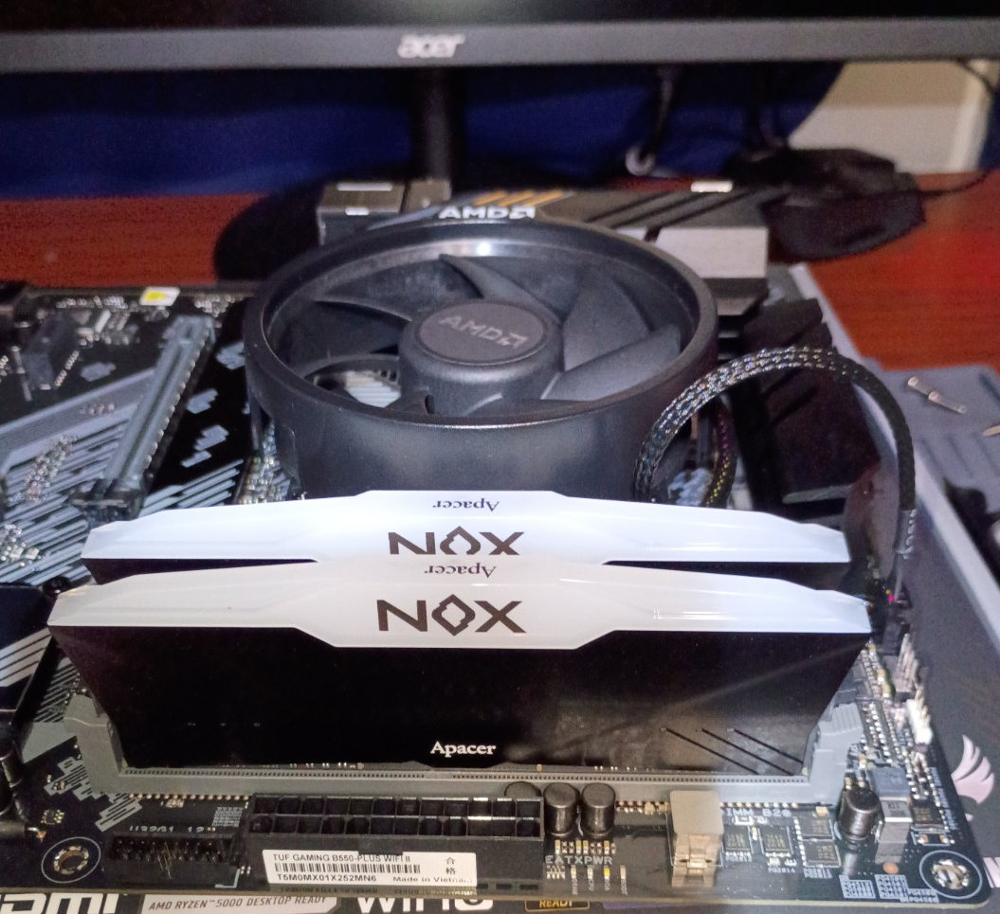
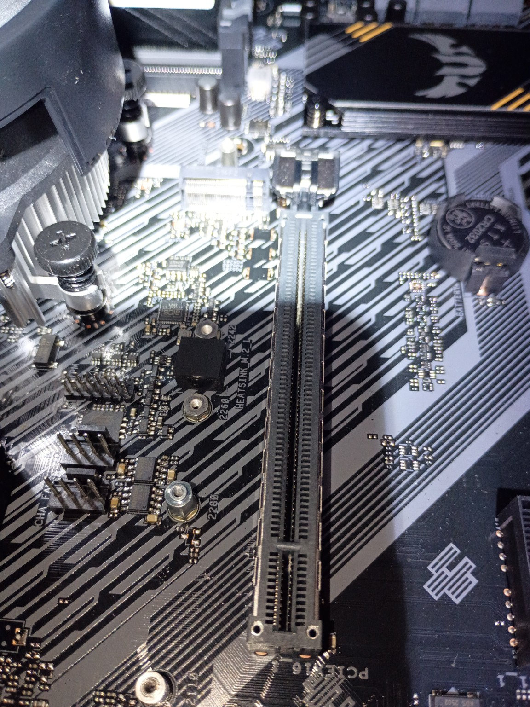
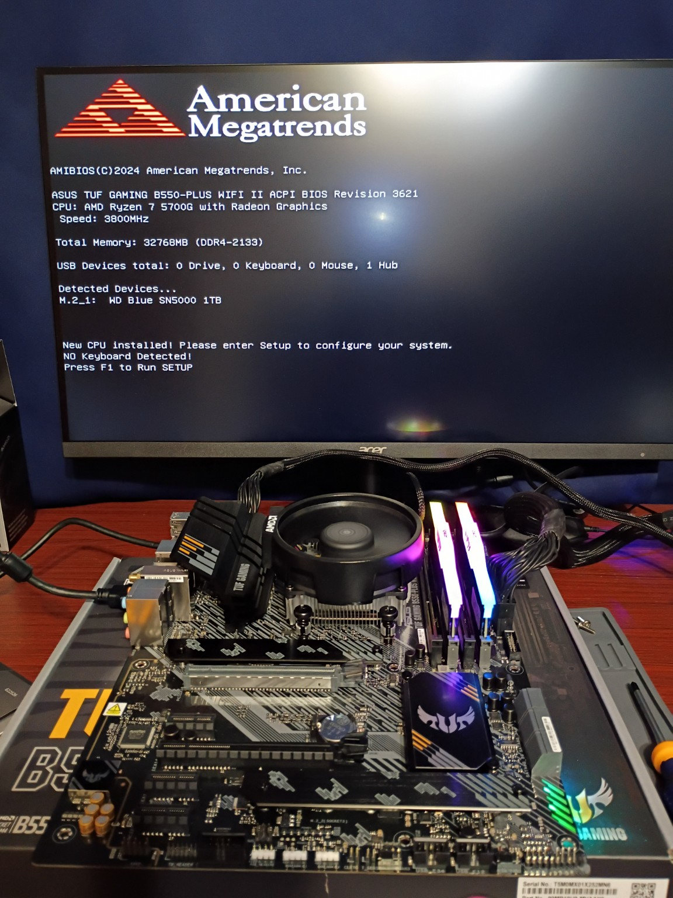
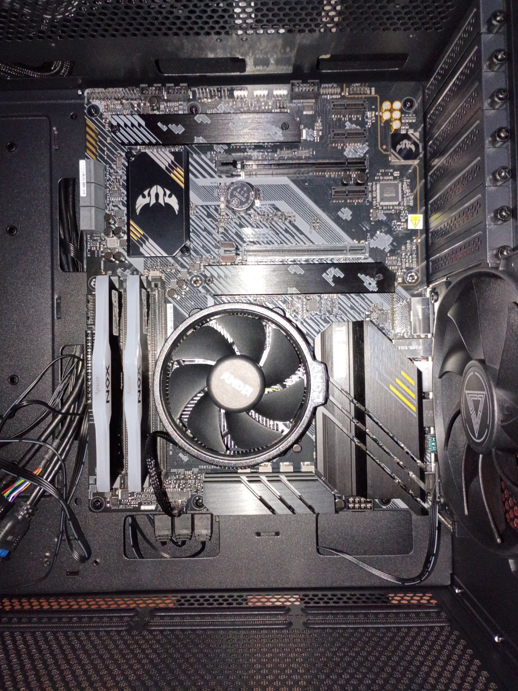
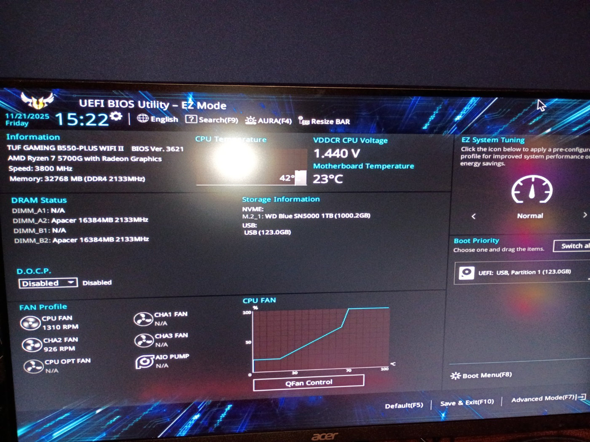
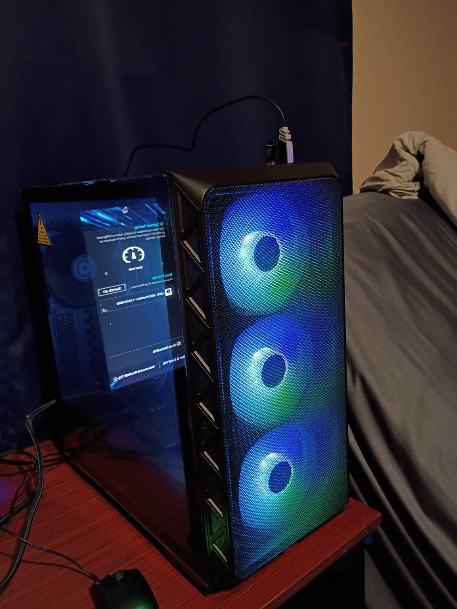
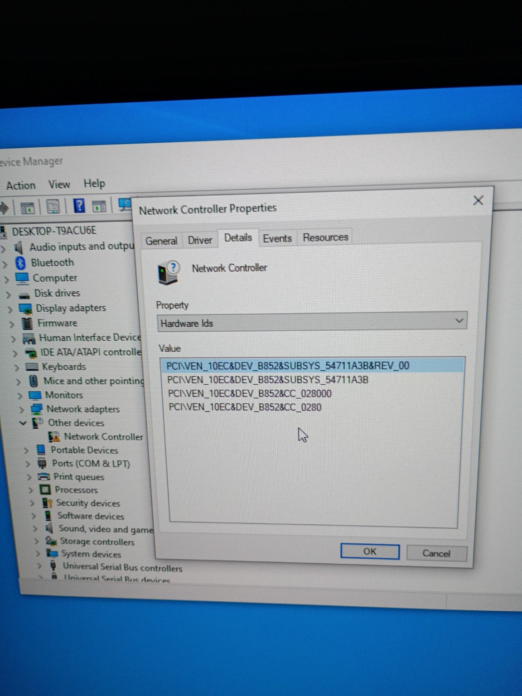
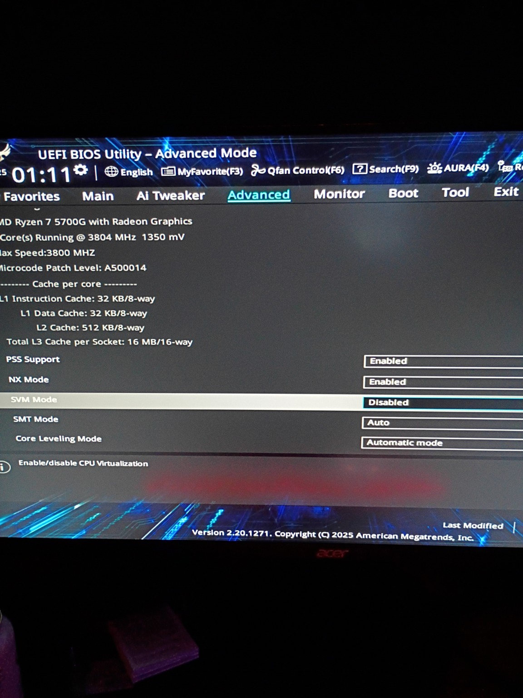
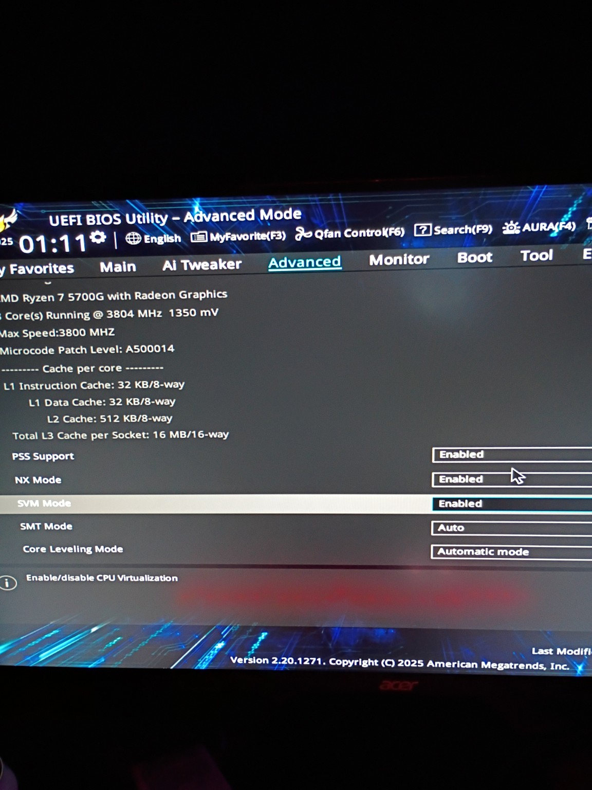

# Custom PC Build | Ryzen 7 5700G + ASUS TUF B550

**Hands-on hardware deployment, troubleshooting, firmware configuration, and operating system installation**

**Project type:** Independent home project  
**Outcome:** Successfully assembled, powered on, and installed an operating system on a custom desktop  
**Current use:** Windows 11 host for a VirtualBox-based IT and cybersecurity home lab

## Project overview

I built this desktop from individual components to strengthen my practical understanding of PC hardware beyond certification study. The goal was not only to assemble a functioning computer, but to understand how its components connect, identify and resolve setup issues, verify hardware detection in UEFI/BIOS, and establish a reliable workstation for further technical learning.

The finished PC became the host for my [Home IT & Cybersecurity Lab](https://github.com/SantiCyberIT/Home-IT-Lab), where I practice Windows Server, Active Directory, DNS, Windows client administration, networking, and security investigations. This build is the **hardware foundation**, not a claim of professional infrastructure-engineering experience.

## Hardware

| Component | Model / configuration |
| --- | --- |
| Processor | AMD Ryzen 7 5700G (integrated graphics) |
| Motherboard | ASUS TUF Gaming B550-PLUS WiFi II |
| CPU cooling | AMD Wraith cooler with Arctic MX-6 thermal paste |
| Memory | 32 GB Apacer DDR4 (2 × 16 GB, A2/B2 slots) |
| Storage | WD Blue SN5000 1 TB NVMe SSD |
| Power supply | Corsair RM850x, 850 W, fully modular |
| Case | Montech Air 903 Max |
| Case cooling | Three front fans, one rear fan, integrated fan/ARGB hub |
| Operating system | Windows 10 Pro initially installed; subsequently Windows 11 |

## What I implemented

The screenshots and photos below come from my own build. They are arranged in the same order as the project work, with the complete [photo-by-photo technical build log](build-log.md) documenting additional components and wiring.

### 1. Motherboard preparation and CPU installation

I prepared the board for assembly, aligned the Ryzen 7 5700G to the AM4 socket, corrected an initial orientation mistake without forcing the pins, and locked the socket lever.

### 2. Cooling, memory, and NVMe storage

I cleaned and reapplied thermal paste, secured the Wraith cooler using alternating turns of the spring-loaded screws, installed the two 16 GB RAM modules in **A2/B2** for dual-channel operation, and installed the 1 TB NVMe SSD under the M.2 heatsink.

### 3. Bench testing before case assembly

Before installing the motherboard inside the case, I connected essential power, memory, cooling, and display components on the motherboard box. The system powered on and reached the firmware POST screen, identifying the CPU, 32 GB RAM, and WD Blue NVMe drive.

### 4. Case assembly, wiring, and fan control

I mounted the Corsair PSU and motherboard in the Montech case, checked standoff alignment, and connected the 24-pin ATX, 8-pin CPU, front-panel, fan, and 5 V ARGB wiring. The [detailed build log](build-log.md) includes close-ups of the individual connectors and cable routing.

### 5. In-case startup and firmware checks

The system completed POST after case installation, and I checked the CPU, RAM, SSD, and temperatures in the ASUS UEFI/BIOS. The photographed screen shows the original DDR4-2133 setting with DOCP disabled at that point; the build log records enabling **DOCP Profile 1** afterward.

### 6. Windows installation and completed hardware

I booted the Windows 10 Pro installer from USB, installed Windows onto the NVMe SSD, and completed initial setup. I later moved to Windows 11 for my home-lab host. The working case fans and RGB lighting are visible in the finished build.

Read the [full assembly, wiring, verification, and troubleshooting log](build-log.md).

## Verification and results

| Check | Observed result |
| --- | --- |
| External bench power-on | CPU fan spun; motherboard powered on; entered BIOS |
| Firmware hardware detection | Ryzen 7 5700G, 32 GB RAM, and NVMe SSD detected |
| Power-on after case installation | System completed POST and entered BIOS |
| Case cooling and lighting | Case fans and connected lighting powered on |
| Firmware temperature | CPU reading around the low 40s °C in BIOS |
| Memory configuration | DOCP Profile 1 enabled |
| Windows installation | Windows 10 Pro installed and initial setup completed |
| Ongoing usefulness | Desktop now supports Windows 11 and the home virtual lab |

These are **checks actually recorded during the build**, not a claim that formal benchmarks, long-duration stress tests, or exhaustive hardware validation were completed.

## Problems encountered and how I approached them

- **CPU would not seat:** Stopped rather than forcing the processor, rechecked the AM4 triangle markers, and corrected the orientation. It then seated without pressure.
- **Cooler spring screws resisted:** Applied controlled downward pressure and tightened the mounting screws gradually in an alternating pattern.
- **Mounting and header layout were unfamiliar:** Verified standoff alignment and identified the correct connectors before fastening the motherboard or powering the fan/ARGB hub.
- **Avoiding unnecessary rework:** Tested the CPU, memory, storage, and basic firmware startup on the motherboard box before installing everything into the case.

These experiences helped reinforce a repeatable habit: **verify assumptions, isolate variables, and test before moving to the next stage**.

## Post-install networking and virtualization

The build also produced two useful troubleshooting/configuration exercises:

**Unrecognized network controller:** Following Windows installation, Device Manager showed an unknown network controller. I inspected its PCI hardware ID (`VEN_10EC / DEV_B852`), gathered driver packages using removable media, and consulted the motherboard vendor's support downloads. A later photo records a successful Wi-Fi connection. The exact driver version finally installed was not separately captured, so this is documented as a troubleshooting sequence rather than an invented driver-installation procedure.

**Enabling virtualization:** Firmware screenshots show AMD **SVM Mode** first set to *Disabled* and subsequently *Enabled*. This configuration is relevant to using the system as the host of my VirtualBox home lab.

The original setting and the later enabled state are both captured:

These additional steps connect the hardware build to practical IT support skills: reading hardware IDs, selecting drivers from manufacturer sources, confirming connectivity, and checking virtualization prerequisites.

## Skills practiced

PC component identification and installation · ESD-aware handling · AM4 CPU/cooler installation · Dual-channel RAM installation · NVMe installation · ATX power and front-panel cabling · 5 V ARGB versus 12 V RGB distinctions · UEFI/BIOS navigation · POST verification · Bootable USB installation · Basic hardware troubleshooting · Technical documentation

## Documentation and next steps

- [Detailed chronological build log](build-log.md) — assembly steps, decisions, troubleshooting, and outcomes
- [Build photos folder](Photos/) — all 24 curated photographs, also embedded next to their corresponding steps in the [detailed build log](build-log.md)
- [Home IT & Cybersecurity Lab](https://github.com/SantiCyberIT/Home-IT-Lab) — the technical lab hosted on this PC

**Documentation scope:** This is a personal, independently completed project. Only observed steps and results are presented as completed. Future photo additions and any new diagnostic tests will be documented separately.
